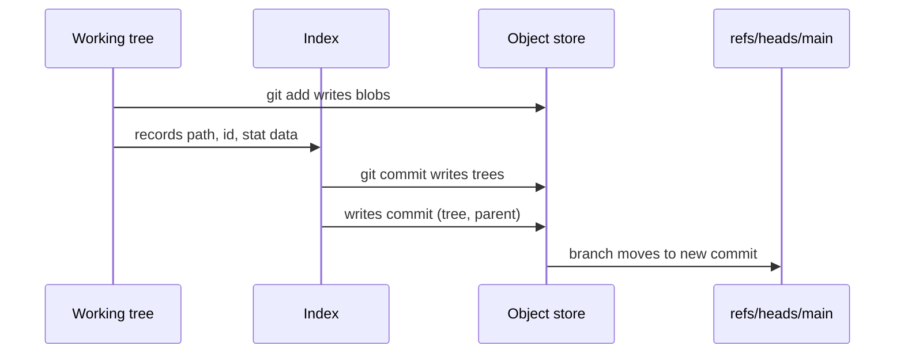

```bytes cover
title: The six bytes Git writes before every file it stores
62 | b
6c | l
6f | o
62 | b
20 | · | space
36 | 6 | size
00 | \0 | NUL {hl}
```

```flow cover
blob 6\0hello\n / 12 bytes in {mono} -[SHA-1]-> ce013625030ba8db… / 20 bytes out: the object's name {mono,hl} -[zlib]-> objects/ce/0136… / 21 bytes on disk {mono}
```

# Orientation

*Git is a key-value store whose keys are hashes of their values. Everything else is bookkeeping on top.*

## Four kinds of object

*A commit is not a diff. It is a pointer to a complete snapshot, and the snapshot is built from just four object types.*

Everything you commit becomes one of four {{object types|object types}}. None of them knows its own name: a {{blob}} is only bytes, and a filename exists only inside the {{tree}} that lists it. That single decision is why renaming a file costs nothing and why identical files anywhere in history are stored once.

```flow
title: The demo repository, second commit
sub: refs → commit → tree → blobs · 8 objects
HEAD / ref: refs/heads/main {ghost} -> main / refs/heads/main {mono} -> commit 5bd513 / "second" {hl} -[parent]-> commit 63f604 / "first" {dim}
>> tree
tree 011831 / root · 2 entries {hl} -[hello.txt]-> blob 3b18e5 / "hello world\n" -[src/]-> tree 37a4b0 / 1 entry -[main.py]-> blob b80e32 / print("hi")
```

Caption: **A branch is a file; the rest are hashes.** HEAD names a branch, the branch names a commit, the commit names one root tree, and trees name blobs and other trees. The first commit's objects are still there, reachable through `parent`.

| Type | Holds | Points to | Demo id |
|---|---|---|---|
| blob | file contents only | nothing | `ce0136` |
| tree | mode, name and id per entry | blobs, trees, commits (submodules) | `011831` |
| commit | tree, parents, author, committer, message | one tree, 0+ commits | `5bd513` |
| tag | target, type, tagger, message | any object | (none) |

Caption: **Four types, one shape.** Each is stored the same way: a short header, then content. Only the content format differs.

### What a commit actually contains

A {{commit}} is a small text object. The one below is printed byte for byte by `git cat-file -p HEAD`; there is no diff anywhere in it.

```kv
title: commit 5bd51306…
tag: object
tree = 0118312260c2ec1fc3d755fb4d2f9e4feabd1bdf  # the whole snapshot {hl}
parent = 63f6041c8173e1a4449827a9056f008f6e79dce3  # previous commit
author = Ada <ada@example.com> 1790845200 +0000
committer = Ada <ada@example.com> 1790845200 +0000
message = second
```

Caption: **Two hashes and two signatures.** Change any byte of the tree, a parent, or the message and the commit gets a new id, which is what makes history tamper-evident.

> [!NOTE] Diffs are computed, not stored
> `git show` and `git log -p` compare two trees at display time. Compression between similar objects happens later and separately, inside packfiles ([[Delta chains|delta chains]]).

## Content addressing

*An object's name is the SHA-1 of its header and its bytes. Two machines that never spoke agree on every id.*

Every id in [[Four kinds of object]] comes from the same recipe. Before hashing, Git prepends a {{header|object header}}: the type, a space, the content length in ASCII decimal, and a NUL byte. The id is the {{SHA-1}} of header plus content. For a file containing `hello` and a newline, that is eleven bytes in, twenty bytes out.

```bytes
title: The bytes that get hashed
sub: blob · "hello\n" · 12 bytes in total
62 6c 6f 62 | "blob" | type
20 | space
36 | "6" | size, decimal ASCII
00 | NUL | ends the header {hl}
68 65 6c 6c 6f 0a | "hello\n" | content
```

Caption: **Six header bytes, six content bytes.** The length is text, not a binary integer, so the header for a 1 MB file is longer than this one.

```console title="Two routes, one id" path="demo repo · git 2.43.0"
$ printf 'blob 6\0hello\n' | sha1sum
ce013625030ba8dba906f756967f9e9ca394464a  -
$ echo hello | git hash-object --stdin
ce013625030ba8dba906f756967f9e9ca394464a
```

Caption: **The header is the whole trick.** A plain `sha1sum` of the header plus content reproduces Git's id exactly.

```steps
title: Writing one object
## Header
`blob 6\0`
type, size, NUL
## Hash {hl}
SHA-1 over header + content
→ `ce0136…`
## Deflate
zlib, level 1 by default
21 bytes here
## Write
temp file, then rename
atomic on POSIX
> safe against crashes
```

Caption: **Hash first, compress second.** The id covers the uncompressed bytes, so changing compression settings never changes an object's name.

> [!WARNING] SHA-1 and SHA-256 do not mix
> `git init --object-format=sha256` has been available since Git 2.29 (experimental). A repository uses one hash for everything; there is no per-object choice and no mixed history.

```timeline
title: Milestones in the format
2005-04 | First commit of Git | Linus Torvalds, self-hosting within days
2005-12 | Git 1.0 | object format essentially as today
2010-04 | Flask's first commit | the repository measured in Part 3
2020-10 | Git 2.29 | experimental SHA-256 object format {hl}
2024-04 | Git 2.45 | reftable backend for refs
```

Caption: **Twenty years, one object model.** New storage around the objects (packs, reftable) arrived; the four object types did not change.

# On Disk

*Before packing, every object is its own small file, and the staging area is a binary cache of the working tree.*

## Loose objects

*New objects land as one compressed file each, filed under the first two hex digits of their id.*

A freshly written object is *loose* (a {{loose object}}): zlib-compressed and stored at `.git/objects/xx/yyyy…`, where `xx` is the first byte of the id in hex. Splitting by the first byte keeps any one directory to a fraction of the objects, which mattered on filesystems that slowed down with large directories.

```tree
title: Where the demo repository keeps things
.git/
  HEAD  # ref: refs/heads/main
  config
  index  · 245 bytes, binary {hl}
  objects/
    01/
      18312260c2ec…  · tree, 83 B
    ce/
      013625030ba8…  · blob, 21 B {hl}
    info/
    pack/  # empty until the first gc
  refs/
    heads/
      main  # 5bd51306…
    tags/
```

Caption: **Two hex digits pick the directory, thirty-eight name the file.** Eight objects, six directories, shown here with two of them expanded.

The demo repository holds eight loose objects after two commits. Their sizes on disk are small and uneven, because zlib output depends on content, and the header is compressed along with it.

```bars
title: Eight loose objects
sub: bytes on disk after zlib · demo repository
unit:  B
commit 5bd513 | 145 | second commit {hl}
commit 63f604 | 118 | first commit
tree 011831 | 83 | root, v2
tree eda784 | 83 | root, v1
tree 37a4b0 | 52 | src/
blob 3b18e5 | 28 | "hello world\n"
blob b80e32 | 28 | main.py
blob ce0136 | 21 | "hello\n"
```

Caption: **558 bytes of content, 32 KiB of disk.** `git count-objects -v` reports `size: 32` because each file occupies a 4 KiB filesystem block. At scale, that per-file overhead is the problem [[Why packs exist|packfiles solve]].

> [!CAUTION] Loose objects are cheap to write and expensive in bulk
> Thousands of tiny files cost inodes, blocks and directory scans. Once more than {{`gc.auto`|gc.auto}} loose objects exist (default 6,700), Git runs `git gc --auto` and packs them into the format described in [[Pack anatomy]].

## Trees, byte by byte

*A tree is a sorted list of entries. The ids inside it are raw bytes, not hex, and directory modes lose their leading zero.*

Trees are the middle layer of [[Fig: The demo repository, second commit]]. Each {{tree entry}} is the {{mode}} in ASCII octal, a space, the name, a NUL, and then the twenty raw bytes of the child's id. There is no entry count and no length prefix: a reader walks entries until the content ends. The demo's root tree is 67 bytes uncompressed.

```bytes
title: Entry one of tree 011831
sub: 37 bytes · mode, name, NUL, raw id
31 30 30 36 34 34 | "100644" | regular file
20 | space
68 65 6c 6c 6f 2e 74 78 74 | "hello.txt" | name
00 | NUL
3b 18 e5 12 db … 8d ad | 20 raw bytes | id 3b18e5…, not hex {hl}
```

Caption: **Names are text, ids are binary.** Printing a tree with `cat` shows garbage after each name because the id is raw bytes.

The second entry is `40000 src`, followed by a NUL and the id of `37a4b0`. Note the five-digit mode: `git cat-file -p` pads it to `040000` for display, but the stored bytes have no leading zero.

| Mode | Meaning | Stored as |
|---|---|---|
| `100644` | regular file | `100644` |
| `100755` | executable file | `100755` |
| `120000` | symbolic link; the blob holds the target path | `120000` |
| `040000` | tree (directory) | `40000` |
| `160000` | gitlink: a commit in a submodule | `160000` |

Caption: **Five modes, not Unix permissions.** Git records only whether a file is executable; every other permission bit is discarded.

## The index

*The staging area is one binary file: a sorted list of paths with cached stat data, so status can skip unchanged files.*

The {{index|index (staging area)}}, `.git/index`, sits between the working tree and the object store. `git add` hashes a file, writes its blob, and records the result here; `git commit` turns the index into tree objects. In the demo it is 245 bytes for two files.

```bytes
title: The index header
sub: .git/index · first 12 bytes
44 49 52 43 | "DIRC" | signature
00 00 00 02 | version 2
00 00 00 02 | 2 entries {hl}
```

```stack
title: Layout of .git/index
sub: version 2 · demo repository · 245 bytes
HEADER | signature, version, entry count | 12 B | 0
Entries | one per path, sorted: ctime, mtime, dev, ino, mode, uid, gid, size, id, flags, path | 2 entries {hl} | 12
Extensions | optional: cached tree (TREE), resolve-undo, split index | 0 or more
CHECKSUM | SHA-1 over everything above | 20 B | 225
end: 245
```

Caption: **Stat data is the speed trick.** If a file's {{stat data}} (size and mtime) match the entry, `git status` assumes the content is unchanged and never re-reads it.

## Refs and HEAD

*A branch is a forty-character text file. HEAD is a file that names a branch.*

Branches live under `refs/heads/`, tags under `refs/tags/`, and each holds a commit id followed by a newline. {{HEAD}} is normally *symbolic* ({{symbolic ref}}): it contains `ref: refs/heads/main` rather than an id. Committing updates the branch that HEAD names, never HEAD itself.



Caption: **Blobs are written at add time, trees and the commit at commit time.** The ref update comes last, so an interrupted commit leaves no dangling branch.

Repositories with many refs pack them into a single text file, {{`packed-refs`|packed-refs}}, one `id name` per line. The bare clone of Flask stores all 73 of its refs that way, with no loose files under `refs/` at all.

# Packfiles

*Loose objects do not scale. A packfile stores every object in one file, most of them as deltas against a similar object.*

## Why packs exist

*Measured on a bare clone of pallets/flask: sixteen years of history, 26,390 objects, packed into 12.7 MB.*

```stats
26,390 | objects | in a single pack
181.7 MB | raw content | headers excluded
12.7 MB | pack file | 14.3× smaller {hl}
```

Caption: **One file instead of twenty-six thousand.** Flask's history runs from 2010-04-06 to 2026-10-07: 5,603 commits, 11,433 trees, 9,318 blobs and 36 tags.

```compare
title: Loose versus packed
## Loose objects
one zlib file per object
cheap to write, one at a time
no sharing between similar versions
a 4 KiB block for a 21-byte object
## Packfile {hl}
all objects in one file plus an index
expensive to build, cheap to read
similar objects stored as deltas
transferable as-is over the network
```

Blobs dominate the raw content but compress hardest, because most of them are small edits to the previous version of the same file. Commits are the opposite: each is unique text, almost never stored as a delta.

```bars
title: Where the pack's bytes go
sub: in-pack bytes by object type · flask.git
unit:  MB
blob | 9.05 | 71% of the pack, 94% of raw content {hl}
commit | 2.19 | 42 of 5,603 deltified
tree | 1.44 | 9,503 of 11,433 deltified
tag | 0.015 | 36 annotated tags
```

Caption: **Blobs shrink 19×, commits barely at all.** 170.2 MB of raw blob content packs into 9.05 MB; 3.04 MB of commits packs into 2.19 MB.

## Pack anatomy

*A twelve-byte header, the objects back to back, and a twenty-byte checksum. The index lives in a second file.*

```strip
title: flask.git · pack-52b6bc9c….pack
sub: 12,697,284 bytes · not to scale
scale: log
HEADER | 12 B | PACK v2
objects | 12,697,252 B | 26,390 entries {hl}
TRAILER | 20 B | SHA-1
start: 0
end: 12,697,284
```

```bytes
title: The pack header
sub: first 12 bytes, big-endian
50 41 43 4b | "PACK" | signature
00 00 00 02 | version 2
00 00 67 16 | 26,390 objects {hl}
```

Caption: **The count is in the header; the offsets are not.** A pack can be streamed and verified front to back, but finding object *n* needs the separate `.idx` file.

The {{pack index|pack index (.idx)}} file is what makes random access fast; the {{fanout table}} it opens with is why [[Fig: Finding one object]] needs only seven comparisons. Every section's size follows from the object count, so its layout can be checked with arithmetic alone.

```flow
title: Finding one object
fanout[0x3b] / first byte of the id -> range in names / ~103 candidates -[binary search]-> offsets[i] / 4 bytes -> seek in .pack / inflate {hl}
```

Caption: **Two table reads and a short binary search.** With 26,390 ids spread over 256 first bytes, each fanout bucket holds about 103 names: seven comparisons.

```stack
title: pack-52b6bc9c….idx, version 2
sub: 739,992 bytes · every section accounted for
scale: sqrt
MAGIC | ff 74 4f 63, version 2 | 8 B | 0
FANOUT | 256 cumulative counts, one per first byte | 1,024 B | 8
Object names | 26,390 × 20-byte ids, sorted | 527,800 B | 1,032 {hl}
CRC32 | 26,390 × 4 bytes, for safe reuse | 105,560 B | 528,832
Offsets | 26,390 × 4 bytes into the .pack | 105,560 B | 634,392
CHECKSUMS | pack SHA-1, then idx SHA-1 | 40 B | 739,952
end: 739,992
```

Caption: **8 + 1,024 + 527,800 + 105,560 + 105,560 + 40 = 739,992.** A table of 8-byte offsets would follow the 4-byte ones for packs over 2 GiB; Flask's has none.

## Delta chains

*Most objects are stored as instructions for rebuilding them from another object. Reading one may mean replaying a chain.*

Inside a {{packfile}}, an object can be stored whole or as a {{delta}}: copy-and-insert instructions applied to a *base* object. The base may itself be a delta, forming a {{chain|delta chain}}. In Flask's pack, two thirds of all objects are deltas.

```bars
title: Delta chain depth
sub: objects by chain length · flask.git · 26,390 total
non-delta | 8,762 | stored whole {hl}
depth 1 | 4,942
depth 2 | 4,166
depth 3 | 2,783
depth 4 | 1,818
depth 5 | 1,218
depth 6–10 | 2,250
depth 11–22 | 451 | max observed: 22 {dim}
```

Caption: **Most chains are short.** 85% of objects sit within four deltas of a full copy. The longest chain here is 22, under the default `pack.depth` limit of 50.

| Setting | Default | Controls |
|---|---|---|
| `pack.window` | 10 | how many nearby objects are tried as a delta base |
| `pack.depth` | 50 | the longest delta chain allowed |
| `gc.auto` | 6,700 | loose objects before `git gc --auto` repacks |
| `gc.autoPackLimit` | 50 | packs before they are consolidated |

Caption: **Window trades CPU for size; depth trades read speed for size.** Raising either makes packs smaller and slower to produce or to read.

> [!TIP] Reading a deep object is cheaper than it looks
> Git keeps a {{delta base cache}}, so walking history (where neighbouring versions share bases) replays each base once rather than once per object.

Sources: git cat-file, git count-objects -v, git verify-pack -v and od on git 2.43.0, 2026-10-10; bare clone of github.com/pallets/flask at d086db8; [gitformat-pack](https://git-scm.com/docs/gitformat-pack); [gitformat-index](https://git-scm.com/docs/gitformat-index); [git-config](https://git-scm.com/docs/git-config).
