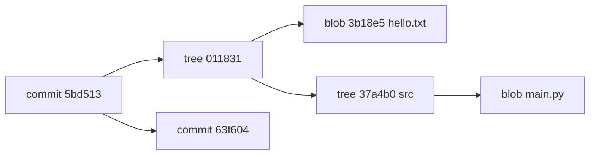

# Git Internals: Research Notes

These notes summarize how Git stores data on disk, based on inspecting a small demo repo and a bare clone of pallets/flask (measured 2026-10-10, git 2.43.0).

## 1. Overview

Git is a content-addressable object store with a thin layer of references on top. Everything you commit becomes one of four object types:

- **blob** - file contents, no filename, no permissions
- **tree** - a directory listing: mode, name, and object id for each entry
- **commit** - points to one tree, zero or more parents, author/committer, message
- **tag** - an annotated tag pointing at another object

A commit points to a tree, which points to blobs and sub-trees. Parents link commits into a history graph.



Key point: the object id is the SHA-1 of the content, so identical content is stored once.

## 2. Object hashing

Each object is stored as a header plus content: `<type> <size>\0<content>`. The id is the SHA-1 of that whole byte string.

Example for a file containing "hello\n" (6 bytes):

```
$ printf 'blob 6\0hello\n' | sha1sum
ce013625030ba8dba906f756967f9e9ca394464a  -
$ echo hello | git hash-object --stdin
ce013625030ba8dba906f756967f9e9ca394464a
```

Both give the same answer, which confirms the header format. The header bytes are: `62 6c 6f 62` ("blob"), `20` (space), `36` ("6"), `00` (NUL), then the 6 content bytes.

Note: Git can also use SHA-256 (`git init --object-format=sha256`), experimental since Git 2.29. Repos cannot mix the two formats.

## 3. Loose objects

New objects are written "loose": zlib-compressed, one file per object, in `.git/objects/<first 2 hex>/<remaining 38 hex>`.

The demo repo after two commits has 8 loose objects:

| object | type | bytes on disk |
|---|---|---|
| 5bd513 | commit (second) | 145 |
| 63f604 | commit (first) | 118 |
| 0118312 | tree (root, v2) | 83 |
| eda784 | tree (root, v1) | 83 |
| 37a4b0 | tree (src) | 52 |
| 3b18e5 | blob hello world | 28 |
| b80e32 | blob main.py | 28 |
| ce0136 | blob hello | 21 |

Total: 558 bytes for 8 objects. `git count-objects -v` reports `count: 8`, `size: 32` (KiB, because each file takes a 4 KiB filesystem block).

Steps when writing an object:
1. Build header + content
2. SHA-1 it to get the id
3. zlib-deflate
4. Write to a temp file, then rename into objects/xx/ (atomic)

Warning: loose objects are cheap to write but expensive in bulk. gc.auto (default 6700) triggers `git gc --auto` to pack them.

## 4. Tree format

A tree object is a sequence of entries, each: `<mode> <name>\0<20 raw bytes of object id>`. Not hex: raw bytes. The root tree of the demo has 2 entries and is 67 bytes uncompressed.

Modes:

| mode | meaning |
|---|---|
| 100644 | regular file |
| 100755 | executable file |
| 120000 | symlink |
| 040000 | tree (directory) |
| 160000 | gitlink (submodule commit) |

Directory structure of .git:

```
.git/
├── HEAD
├── config
├── index
├── objects/
│   ├── 01/
│   ├── ce/
│   ├── info/
│   └── pack/
└── refs/
    ├── heads/
    │   └── main
    └── tags/
```

## 5. The index

The index (`.git/index`) is the staging area. It is a binary file: header "DIRC", version (2), number of entries, then one entry per tracked file (stat data + mode + object id + path), then extensions, then a SHA-1 checksum of everything before it.

Demo repo index: 245 bytes, version 2, 2 entries. Header bytes: `44 49 52 43 00 00 00 02 00 00 00 02`.

The stat data (ctime, mtime, dev, inode, uid, gid, size) lets `git status` skip re-hashing files that have not changed.

## 6. Refs

A branch is a file containing a commit id. HEAD is usually a symbolic ref: `ref: refs/heads/main`. When there are many refs, Git packs them into `packed-refs`. The flask clone has 73 refs in packed-refs.

What `git commit` does, in order:
1. writes blobs for staged content (already done at `git add`)
2. writes tree objects from the index
3. writes the commit object
4. updates the branch ref that HEAD points to

## 7. Packfiles

Packfiles store many objects in one file with delta compression. Measured on a bare clone of pallets/flask:

- 26,390 objects in a single pack
- 5,603 commits, 11,433 trees, 9,318 blobs, 36 tags
- Uncompressed object content: 181,722,565 bytes (181.7 MB)
- .pack file: 12,697,284 bytes (12.7 MB), so about 14.3x smaller
- .idx file: 739,992 bytes
- history from 2010-04-06 to 2026-10-07

Pack header: `50 41 43 4b` ("PACK"), version `00 00 00 02`, object count `00 00 67 16` = 26,390. Then the objects, then a 20-byte SHA-1 trailer.

Bytes in pack by type:

| type | objects | in-pack bytes | deltified |
|---|---|---|---|
| blob | 9,318 | 9,050,565 | 8,083 |
| commit | 5,603 | 2,190,249 | 42 |
| tree | 11,433 | 1,441,815 | 9,503 |
| tag | 36 | 14,623 | 0 |

Interesting: blobs are 94% of the raw content but only 71% of the pack.

## 8. Pack index (.idx v2)

The .idx lets git find an object in the pack without scanning. Layout:

- magic `ff 74 4f 63` + version 2 (8 bytes)
- fanout table: 256 x 4-byte counts (1,024 bytes)
- sorted object names: 26,390 x 20 bytes (527,800)
- CRC32s: 26,390 x 4 (105,560)
- 4-byte offsets: 26,390 x 4 (105,560)
- (8-byte offsets only for packs > 2 GiB; none here)
- pack checksum + idx checksum (40)

Sum = 739,992 bytes, exactly the file size.

Lookup: fanout[first byte] gives the range, binary search within it, then read offset.

## 9. Delta chains

Most objects in the pack are stored as deltas against another object. Chain length distribution for flask:

- non-delta: 8,762
- depth 1: 4,942
- depth 2: 4,166
- depth 3: 2,783
- depth 4: 1,818
- depth 5: 1,218
- depth 6-10: 2,250
- depth 11-22: 451

Max depth observed is 22. Default pack.depth is 50, pack.window is 10.

Reading a depth-22 object means applying 22 deltas. Git has a delta base cache to make that cheaper.

Sources: git cat-file, git verify-pack -v, git count-objects -v on git 2.43.0; Documentation/gitformat-pack.txt; Documentation/gitformat-index.txt.
